# waste_detection

**Finding illegal waste dumps, and plastic waste in particular, in high-resolution aerial imagery of Almería, Spain.**

Almería holds Europe's "sea of plastic": tens of thousands of hectares of plastic greenhouses. This repository
trains and evaluates models that scan 30 cm aerial photos square by square and rank the places most likely to
hold dumped waste, so inspectors can check the best candidates first. The hard part is telling greenhouse
plastic in use apart from plastic that has been dumped.

| | |
|---|---|
| **Final result (v2)** | Ranking AP **0.86** (from 0.51), false alarms **3** (from 8-10), plastic AP **0.68** (from 0.27) on a one-time test on unseen land |
| **Study areas** | Níjar and Campo de Dalías (La Mojonera / Las Norias), 3.5 km × 3.5 km each |
| **Local labels** | 1,300 squares labelled by eye at full resolution, 103 dumps |
| **Imagery** | PNOA orthophotos, 30 cm per pixel, free (IGN Spain, CC BY 4.0) |
| **Models** | ConvNeXt-Tiny scene classifier (waste + 7 waste types) and Faster R-CNN pile detector |
| **Method** | Same recipe as the leading group in the field (Politecnico di Milano, AerialWaste) |

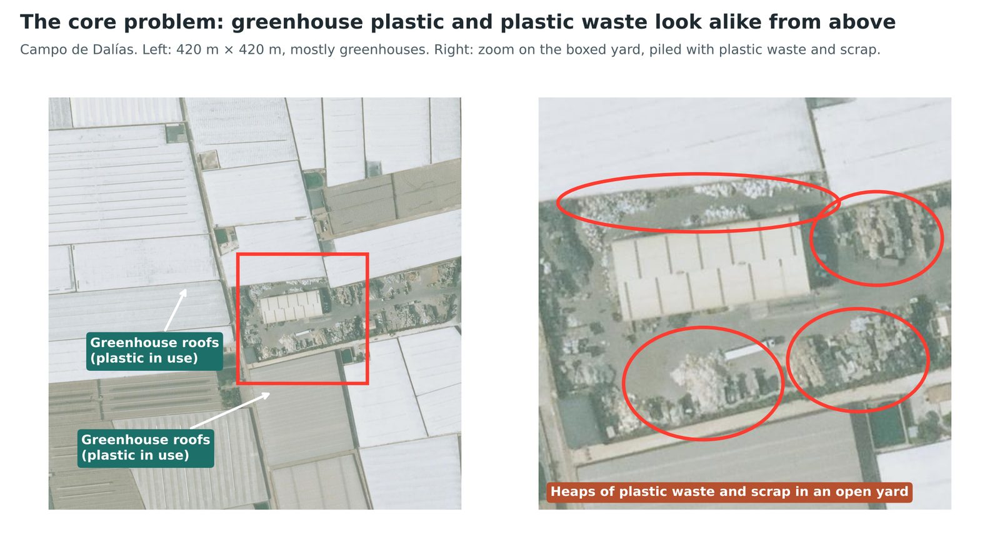

## Contents

1. [The problem](#1-the-problem)
2. [How the system works](#2-how-the-system-works)
3. [How results improved: three scenarios](#3-how-results-improved-three-scenarios)
4. [Final results](#4-final-results)
5. [Outside check: public dump reports](#5-outside-check-public-dump-reports)
6. [Box detector](#6-box-detector)
7. [Problems we hit and how we solved them](#7-problems-we-hit-and-how-we-solved-them)
8. [Limitations and next steps](#8-limitations-and-next-steps)
9. [Run order (Google Colab)](#run-order-google-colab-t4-gpu) · [Repository](#repository) · [Data and licences](#data-and-licences)

## 1. The problem

Almería has one of the largest concentrations of plastic greenhouses in the world. A model that learns
"white plastic = waste" flags every greenhouse, so the real task is separating greenhouse plastic in use
from plastic dumped in fields, dry riverbeds (ramblas) and roadsides. We worked in two areas: Níjar in the
east and Campo de Dalías, the heart of the greenhouse belt, in the west.

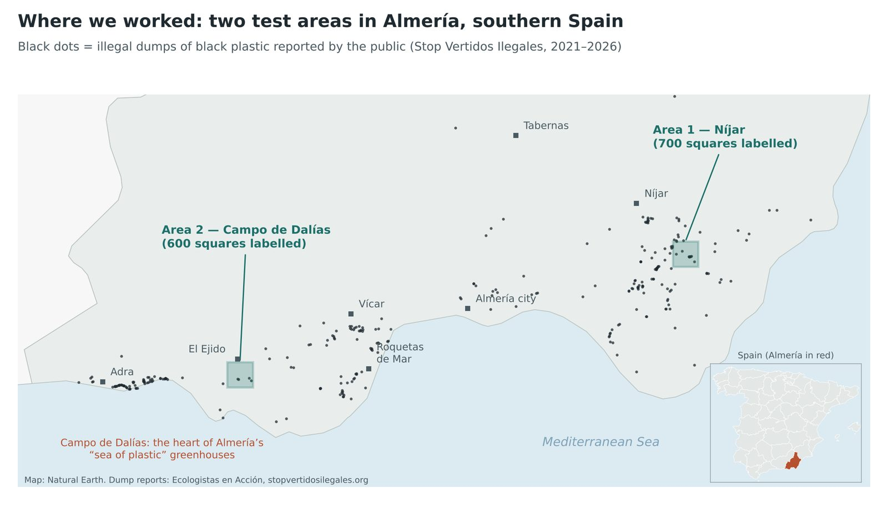

What waste sites look like at 30 cm per pixel (waste circled in red):

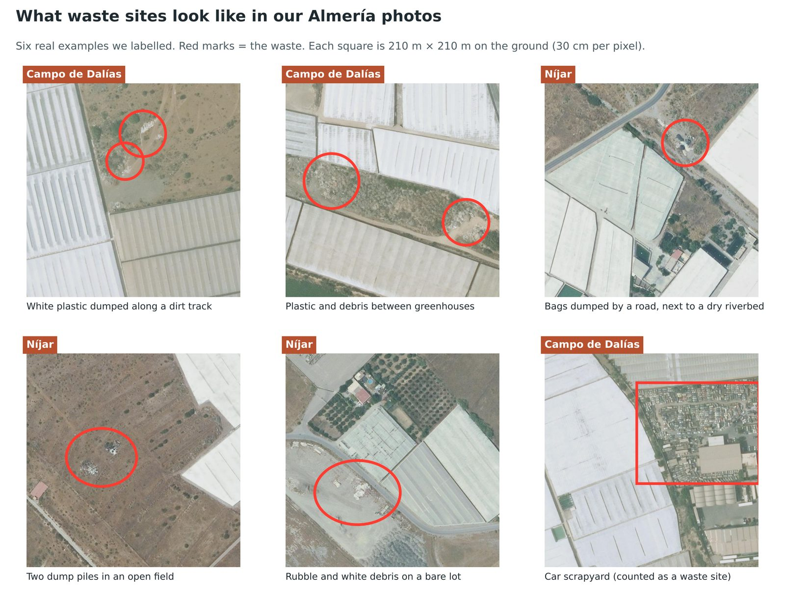

## 2. How the system works

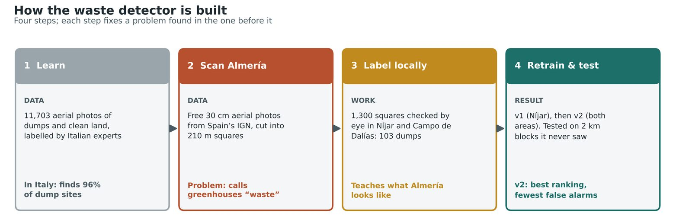

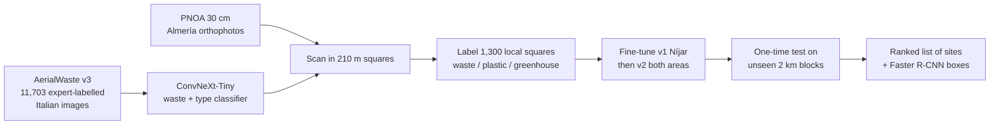

| Step | What | Data | Model |
|---|---|---|---|
| 1 | Waste / no waste for each 210 m × 210 m window, plus waste type (**plastic**, rubble, bulky items, scrap, tyres, wood, vehicles) | AerialWaste v3: 11,703 images labelled by professional photo interpreters (ARPA Lombardia) | ConvNeXt-Tiny, multi-task heads, unknown type labels masked |
| 2 | Boxes around dump piles | Roboflow "Aerial-Dumping-Sites" v6 | Faster R-CNN ResNet-50-FPN v2 |
| 3 | Scan an Almería area and list candidate sites | PNOA orthophotos | models 1 + 2 |
| 4 | Label Almería squares, fine-tune, test on separate 2 km blocks | own labels | model 1, fine-tuned |

**Base model.** On held-out Italian test images the classifier finds 96% of waste sites with 6% false
alarms (AP 0.976), against AP 0.78 for a classic colour-and-texture baseline.

**Scanning.** An area is cut into 210 m squares, with extra squares half a step apart so no dump falls
between two squares. Each square gets a waste score and a plastic score.

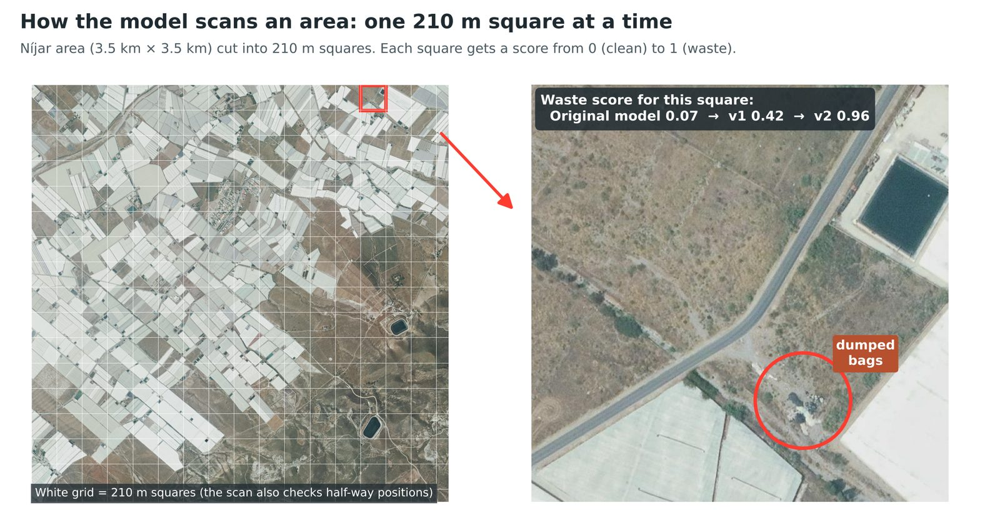

**Labelling.** Each square gets three answers: waste? plastic? greenhouse? Unclear squares are skipped,
because a wrong label hurts more than a missing one. Squares are sampled from the model's top scores
(its own false alarms), near the decision line (hard cases) and at random (honest numbers).

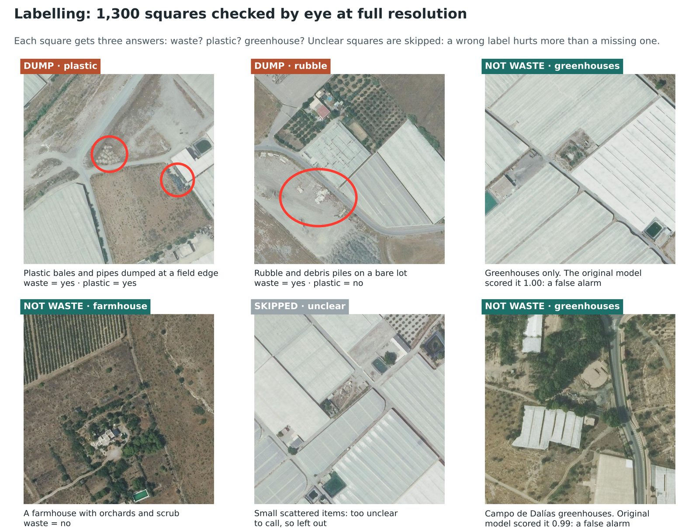

| Area | Squares labelled | Dumps | Visible plastic | Not waste | Skipped |
|---|---|---|---|---|---|
| Níjar | 700 | 76 | 23 | 564 | 60 |
| Campo de Dalías | 600 | 27 | 12 | 503 | 70 |

**Fair testing.** Neighbouring squares look alike, so the land is cut into 2 km blocks and each whole block
is training, tuning or test. The best epoch and every threshold are picked on tuning blocks; test blocks are
scored once, and the code refuses to score them twice.

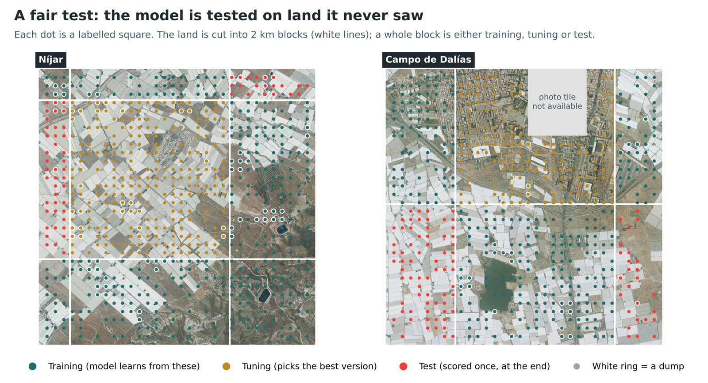

### Evaluation rules

- The **test** split is scored once; `*_test_report.json` is written the first time and a later attempt stops with an error.
- Leakage checks: Roboflow's augmented copies stay together; near-duplicate training images of test images are removed (56 found in the detector data); Almería splits are 2 km blocks.
- Every model is compared with a **classic method** on the same images (hand-crafted colour, edge and texture features with logistic regression; a "white plastic" pixel rule for plastic).
- Almería numbers come with 95% bootstrap intervals, because local test sets are small.

### Same approach as the leading research group

The method follows the recipe of the Politecnico di Milano group behind AerialWaste, whose detector is in
operational use with an Italian regional environmental agency (in a field trial, photo interpreters found
155 waste sites with its help against 95 by hand).

| | Politecnico di Milano | This project |
|---|---|---|
| Imagery | 20-30 cm aerial photos, RGB | 30 cm PNOA aerial photos, RGB |
| Model | Scene classifier (Swin-T, ResNet-50) | Scene classifier on 210 m squares (ConvNeXt-Tiny) |
| Labels | Expert photo-interpreter labels (AerialWaste) | AerialWaste + 1,300 local Almería labels |
| Against false alarms | Clean examples taken next to real dumps | Look-alike greenhouse and farm squares labelled next to dumps |
| New regions | Italy → Greece, measured locally | Italy → Almería, adapted with local labels, tested on 2 km blocks |
| Output | Ranked list for interpreters | Ranked list for inspectors, adjustable alert cut-off |

What is new here is the setting: dumped plastic among greenhouses, which no published work covers.
Sources: [Gibellini, Fraternali, Boracchi et al., 2025](https://arxiv.org/pdf/2502.06607v1);
[Fraternali et al., survey, 2024](https://www.arxiv.org/pdf/2402.09066);
[Politecnico di Milano / PERIVALLON](https://www.eurekalert.org/news-releases/1091286).

## 3. How results improved: three scenarios

Each scenario is a measured result that exposed a problem, followed by the decision that fixed it.

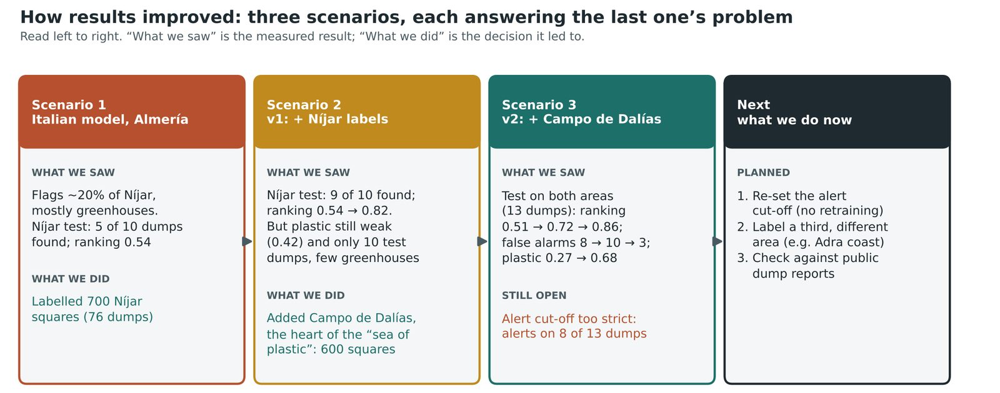

### Scenario 1: the Italian model on Almería

Scanning Níjar, the Italian-trained model flagged 201 of 1,024 squares (about 20%), mostly intact
greenhouses. On the Níjar test blocks it found 5 of 10 dumps (AP 0.54). It had never seen a greenhouse.
**Decision:** label 700 Níjar squares and fine-tune, mixed with the Italian images so it does not forget.

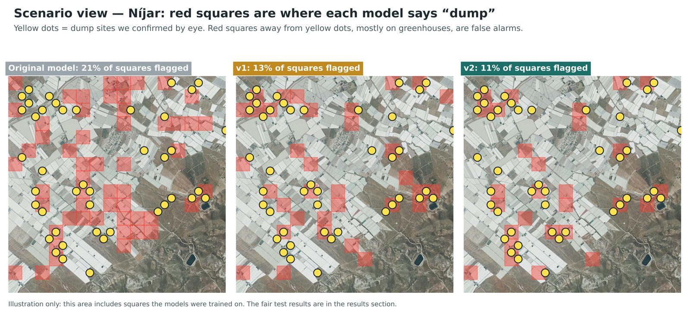

### Scenario 2: v1, fine-tuned on Níjar

Níjar test: 9 of 10 dumps found (from 5), 82% of alerts real (from 63%), AP 0.82. Still weak: plastic AP
only 0.42, some greenhouse false alarms, and only 10 test dumps from one landscape.
**Decision:** add Campo de Dalías, the densest greenhouse area, full of greenhouses next to real dumps
(the original model flagged 110 of its 600 labelled squares, only 18 of them real dumps).

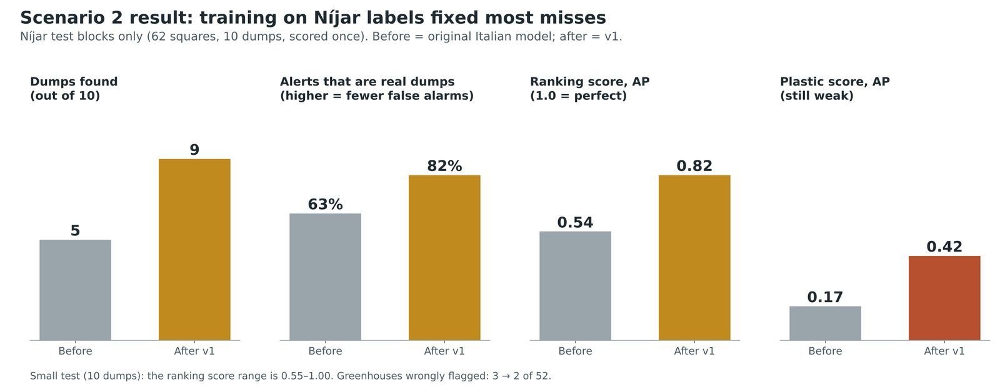

### Scenario 3: v2, fine-tuned on both areas

62 training dumps instead of 24 (two whole tuning blocks moved to training, no leakage), 8 epochs instead
of 6, and a bigger test (Níjar + Dalías test blocks, 13 dumps). v2 flags about half as many Dalías
squares as the original model, with more of its alerts next to real dumps.

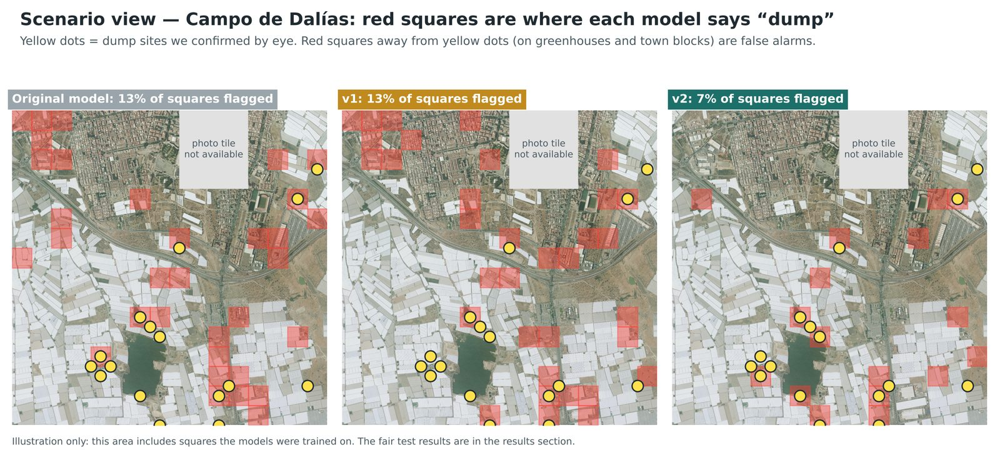

The two alert maps include training squares, so they illustrate behaviour; the fair numbers are below.

## 4. Final results

One-time test, both areas, 155 squares, 13 real dumps, scored on 15 November 2026:

| | Starting model | v1 | v2 |
|---|---|---|---|
| Ranking AP (1.0 = perfect) | 0.51 | 0.72 | **0.86** (95% CI 0.68-0.99) |
| False alarms (of 142 clean squares) | 8 | 10 | **3** |
| Precision at the chosen threshold | 47% | 55% | **73%** |
| Plastic-type AP | 0.27 | 0.39 | **0.68** |
| Dumps alerted on (of 13) | 7 | **12** | 8 |

Per area (v2): Níjar AP 0.93 with 1 false alarm; Campo de Dalías AP 0.87, 3 of 3 dumps alerted, 2 false alarms.

v2's alert threshold (0.93) was chosen on tuning blocks and proved too strict on the test blocks, so it
alerts on 8 of 13 dumps although it ranks them well. Re-setting it needs no retraining.

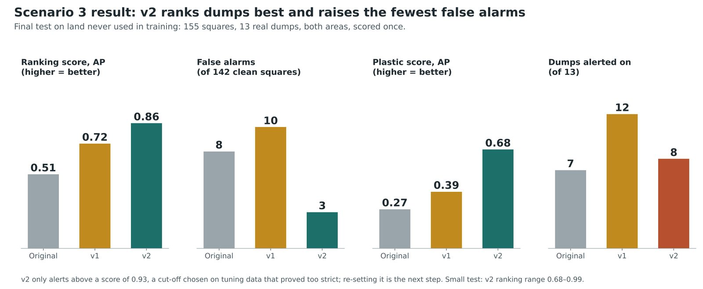

Before and after on four test squares: greenhouses the starting model called waste now score near zero,
and dumps it missed now score near one.

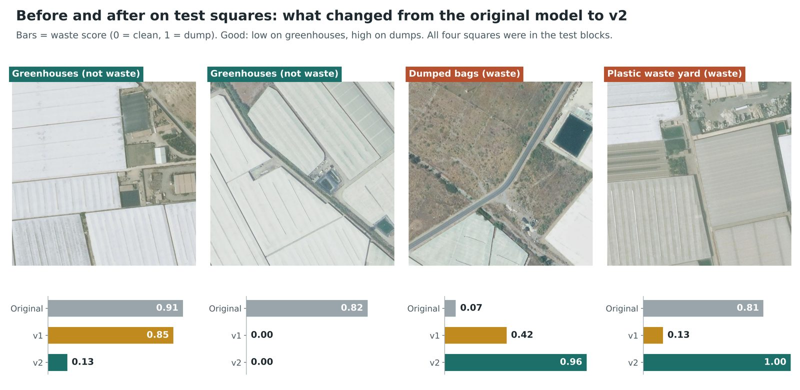

Where each model looks (class activation maps): v2 ignores greenhouse roofs and points at the dumped material.

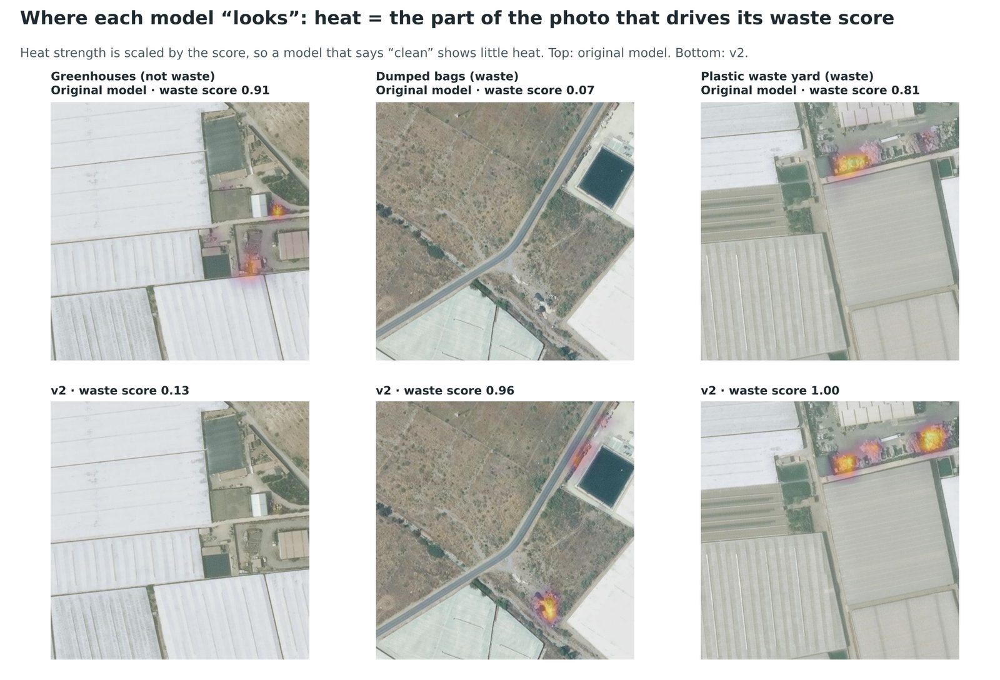

## 5. Outside check: public dump reports

The public [Stop Vertidos Ilegales](https://stopvertidosilegales.org/residuos-agricolas/plastico-negro/) map
(Ecologistas en Acción) lists 287 "black plastic" dump reports in Almería province (2021-2026), each with a
location, date and ground photos. Níjar has the most (109). Of the 11 reports inside our Níjar area,
7 fall on squares we had already labelled as dumps; at the other 4 the photo shows no visible waste
(most likely cleared between report and photo).

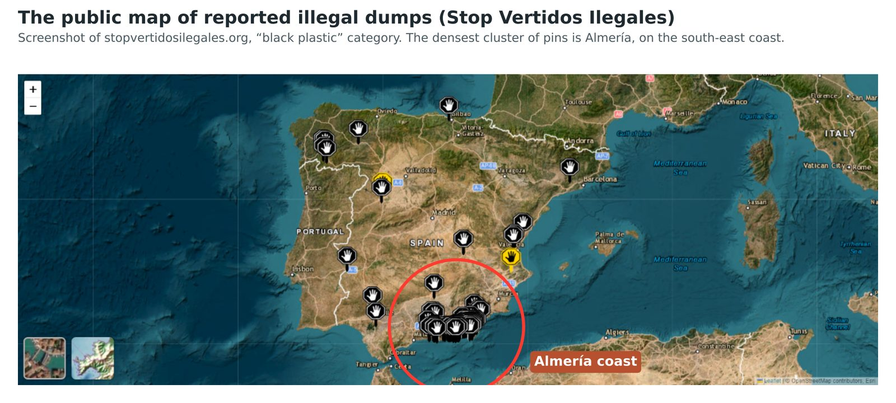

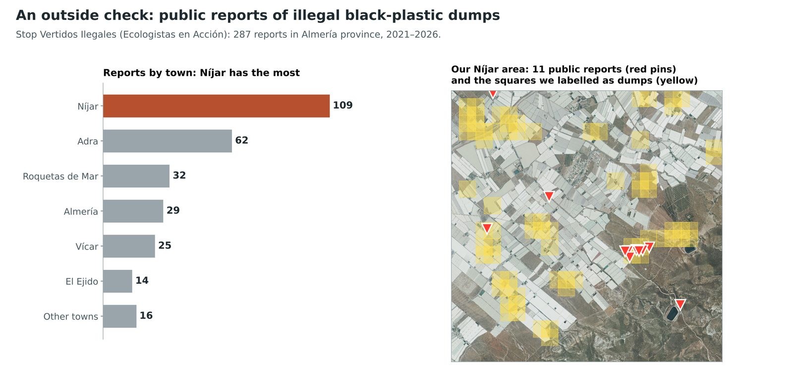

## 6. Box detector

The classifier says *where* to look; a Faster R-CNN detector draws a box around each pile. mAP50 **0.36**
on a cleaned test set. The earlier YOLOv8 baseline's 0.42 was inflated: 56 of its test images were copies
of training images and its model was chosen on the test set. Ultralytics YOLO is not used because of its
AGPL-3.0 licence.

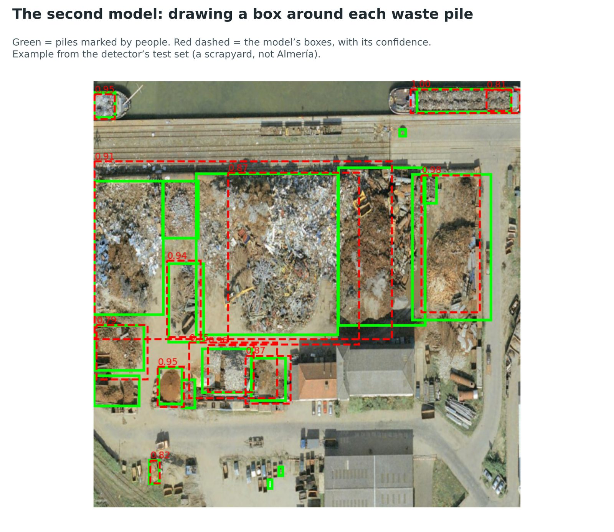

## 7. Problems we hit and how we solved them

| Problem | What we did |
|---|---|
| Italian model called ~20% of Níjar "waste", mostly greenhouses | Labelled 1,300 local squares, including 1,067 clean look-alikes, and fine-tuned |
| Plastic weak (AP 0.27): only 126 plastic images in AerialWaste | Shared multi-task network + local plastic labels → plastic AP 0.68 |
| After v1, plastic still weak and only 10 test dumps from one landscape | Added Campo de Dalías as a second area |
| Most labelled dumps sat in tuning blocks (24 left to learn from) | Moved two whole tuning blocks to training → 62 training dumps, no leakage |
| Neighbouring squares look alike | 2 km block splits; one-time test enforced in code |
| 56 detector test images were copies of training images | Removed them; model chosen on validation only |
| YOLO's AGPL licence | Faster R-CNN from torchvision; all code written from scratch |
| Free Colab GPU ran out mid-training | Checkpoint every epoch to Drive; training resumes where it stopped |
| PNOA server sometimes returned HTTP 503 | Scans save tile by tile and skip a failed tile |
| v2 alert threshold too strict | Open: re-set on tuning data for ~90% recall |

## 8. Limitations and next steps

| Limitation | Effect | How we address it |
|---|---|---|
| Labels come from photos, not ground visits | Some labels may be wrong | Check against public reports and field visits |
| Small test set (13 dumps) | Wide intervals (v2 AP 0.68-0.99) | Label more areas; always report intervals |
| Only two landscapes (greenhouse plains) | Likely weaker on coast, ravines, town edges | Label a third area, e.g. the Adra coast |
| Alert threshold too strict | 8 of 13 test dumps alerted | Re-set threshold (no retraining) |
| Plastic from RGB is a best guess | Plastic score ranks, does not prove material | SWIR imagery (e.g. WorldView-3) |
| Photos are a snapshot | Sites may be cleared or new | Re-scan when new PNOA photos are published |
| Box detector is basic (mAP50 0.36) | Some piles missed | Retrain at higher resolution, fair YOLO comparison |
| Output is a list, not proof | Every site needs inspection | Use as a ranked inspection list |

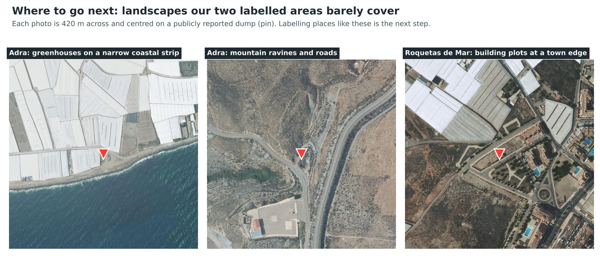

**Next steps, in order of expected gain:** re-set v2's threshold; label a third, different area; add a free
greenhouse map (Global-PCG-10); get dated report locations from Ecologistas en Acción as ground truth;
improve the detector; later, one WorldView-3 SWIR image for true plastic identification.

## Imagery

The models are built for very-high-resolution RGB images at **20-60 cm per pixel**: aerial orthophotos or
satellites such as WorldView, Pléiades Neo or Google Earth exports. At 10 m (Sentinel-2) a whole dump is a
few pixels, so it cannot be used. Any image of similar resolution can be scanned with `scan.scan_image`.

## Run order (Google Colab, T4 GPU)

| Notebook | Time | What you need |
|---|---|---|
| `01_aerialwaste_classifier` | ~30 min download (first time only) + ~1.5 h training | nothing (Zenodo is public) |
| `02_dumpsite_detector` | ~1 h | a Roboflow API key |
| `03_almeria_scan_and_label` | minutes for the demo area | a few hours of labelling (in-notebook buttons) |
| `04_almeria_finetune` | ~1-2.5 h (resumes after a disconnect) | the labelled sheets from 03 (every labelled area is used) |

To open a notebook:
`colab.research.google.com/github/inayatarshad/waste_detection/blob/main/notebooks/<name>.ipynb`

Choose **Runtime > Change runtime type > T4 GPU**, run all cells, and click "Connect to Google Drive" when
asked. All outputs (checkpoints, ONNX files, reports, figures, scan maps) go to
`MyDrive/waste_runs/`.

## Re-running without losing time

Everything slow is saved to Google Drive (`MyDrive/waste_runs/`), so a rerun skips work that is already done:

| Saved on Drive | What it saves you |
|---|---|
| `aerialwaste_640.tar` | the 18.8 GB Zenodo download plus resizing (about 3 h); a rerun only unpacks it (a few minutes) |
| `classifier_v1/baseline_features.npz` | the classic-baseline feature pass |
| `classifier_v1/last.pt` (written after every epoch) | training: after a disconnect, re-run the notebook and it continues from the last finished epoch |
| `classifier_v1/best.pt` | the best model so far; `USE_EXISTING_BEST = True` in the training cell skips training entirely |
| `detector_v1/last_det.pt` | the same for the detector |
| `pnoa_cache/` | downloaded Almeria orthophotos |
| `almeria_labels/sheet_*.csv` | your labels, saved after every click |

The test split is still scored only once: `test_report.json` is written the first time,
and a later attempt stops with an error.

## Repository

```
configs/      Almeria scan areas
notebooks/    01-04 (Colab)
src/wastedet/ aerialwaste.py   dataset reader, splits, augmentation
              dumpsites.py     YOLO-box reader, grouped splits, box augmentation
              models.py        classifier (+ attention map), detector, ONNX export
              metrics.py       AP, thresholds, detection mAP, bootstrap intervals
              baselines.py     classic methods
              train_cls.py     classifier training / one-time test
              train_det.py     detector training / one-time test
              geo.py           coordinates, PNOA WMS, scan grid, block splits
              scan.py          window scanning, candidate sites, GeoJSON, labelling sheet
              almeria.py       Almeria labels and dataset mixing
              plots.py         figures
tests/        pytest suite on synthetic data (no downloads needed): python -m pytest -q
```

## Data and licences

- **AerialWaste**: Torres & Fraternali, *Scientific Data* 10, 63 (2023), Zenodo record 12607190. The Zenodo record is CC BY 4.0, but some images come from Google Earth, and their use must follow Google's terms. The authors' own toolkit and model repositories are CC BY-NC-ND. We do not use their code or weights; everything here is written from scratch.
- **Aerial-Dumping-Sites v6**: Roboflow Universe, CC BY 4.0, with attribution to the dataset authors.
- **PNOA**: "PNOA cedido por (c) Instituto Geografico Nacional de Espana", CC BY 4.0.
- **Libraries**: PyTorch / torchvision (BSD) and timm (Apache-2.0). Ultralytics YOLO is deliberately not used, because it is AGPL-3.0.

**Before any commercial use**, check the Google Earth imagery terms that apply to the AerialWaste subset.

